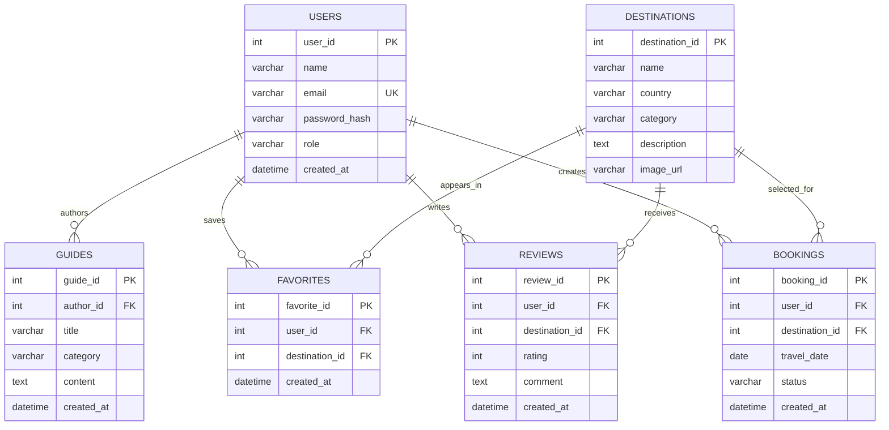

# TravelExplore — Entity Relationship Diagram (ERD)

This ERD is a **database draft** for a future backend milestone. The database is not connected to the current frontend.

- **PK** means Primary Key.
- **FK** means Foreign Key.
- **UK** means Unique Key.

## Entities

1. **USERS** — registered users and their role. `email` should be unique; `password_hash` stores a secure hash, never a plain-text password.
2. **DESTINATIONS** — destinations displayed in the application.
3. **GUIDES** — travel guides. `author_id` references the user who authored a guide.
4. **FAVORITES** — a linking entity between users and destinations.
5. **REVIEWS** — user ratings and comments for destinations. `rating` should be constrained to the range 1–5.
6. **BOOKINGS** — planned trips or bookings created by users.

## Relationships

- One user can author many guides; each guide has one author.
- One user can save many destinations; one destination can be saved by many users.
- One user can write many reviews; one destination can receive many reviews.
- One user can create many bookings; a destination can be associated with many bookings.
- `FAVORITES` resolves the many-to-many relationship between users and destinations.

## Recommended constraints

- Add a unique constraint to `FAVORITES(user_id, destination_id)` so a user cannot save the same destination twice.
- Use foreign keys for every listed FK.
- Require `REVIEWS.rating` to be between 1 and 5.
- Use suitable status values for `BOOKINGS.status`.
- Store timestamps consistently, preferably in UTC.

## Diagram image

A rendered diagram is available in [`ERD.png`](ERD.png) for use in reports and presentations.
